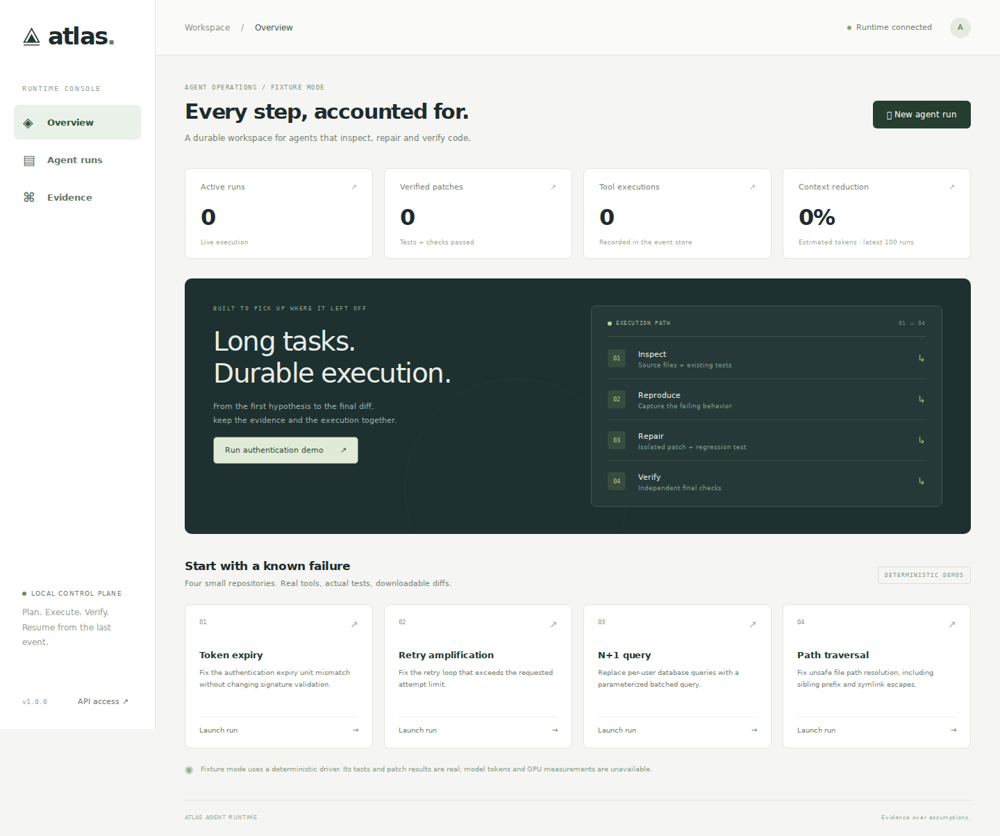
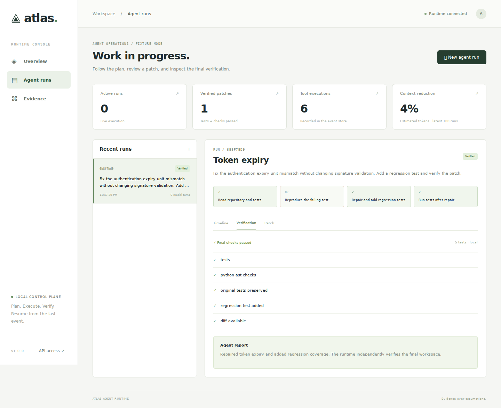
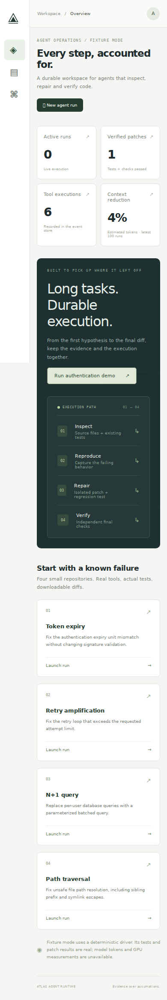

# Console checks

Captured from the working local app after a real fixture workflow. Screenshots are reference images; the console reads its current state from the API.

## Desktop overview

## Verified run

## Mobile overview

